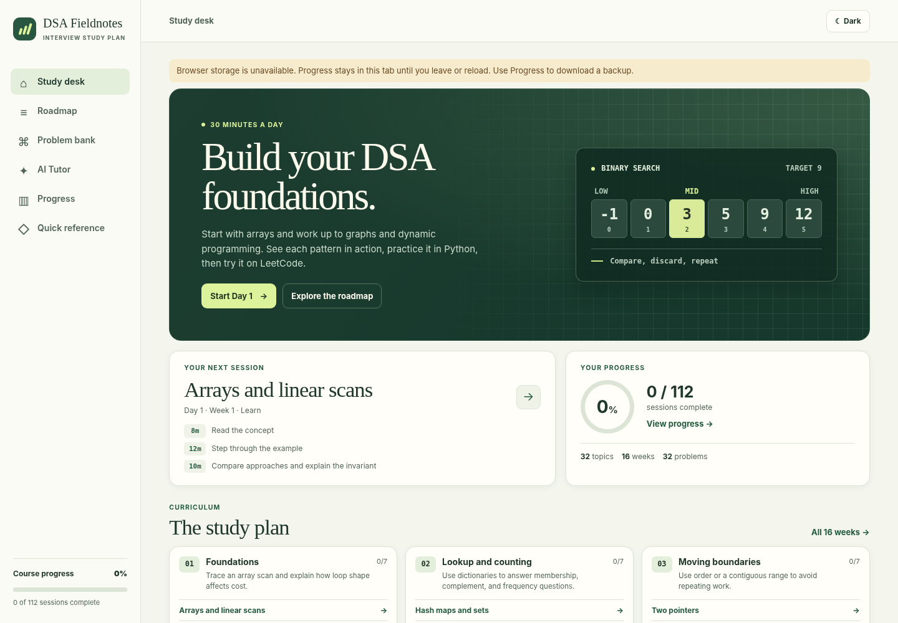
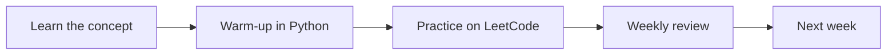
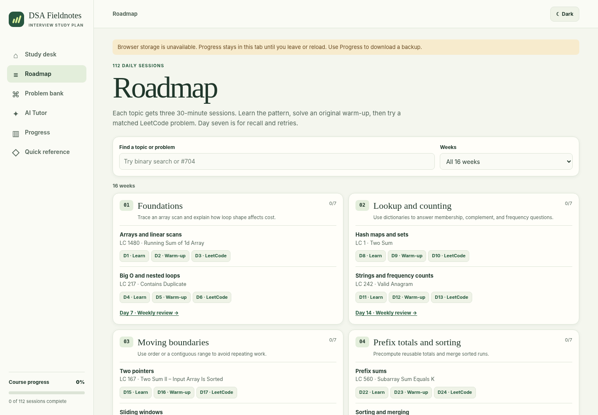
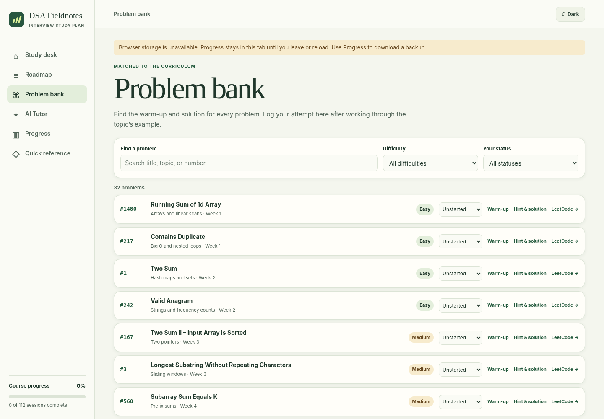
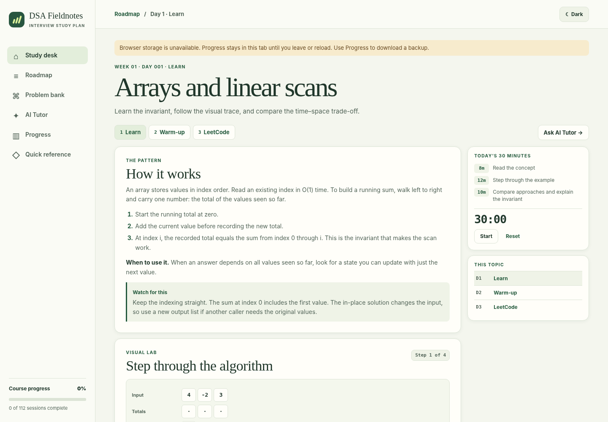
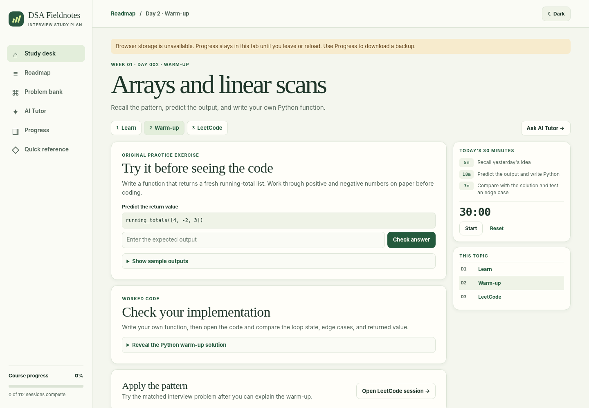
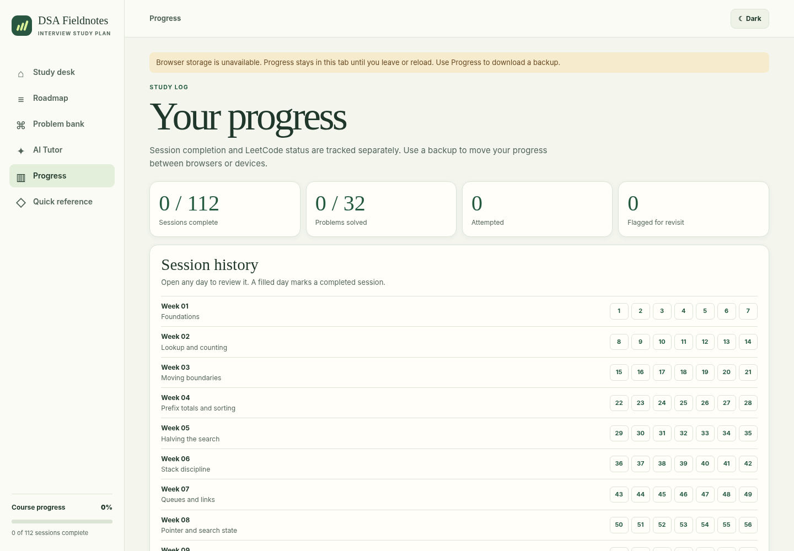
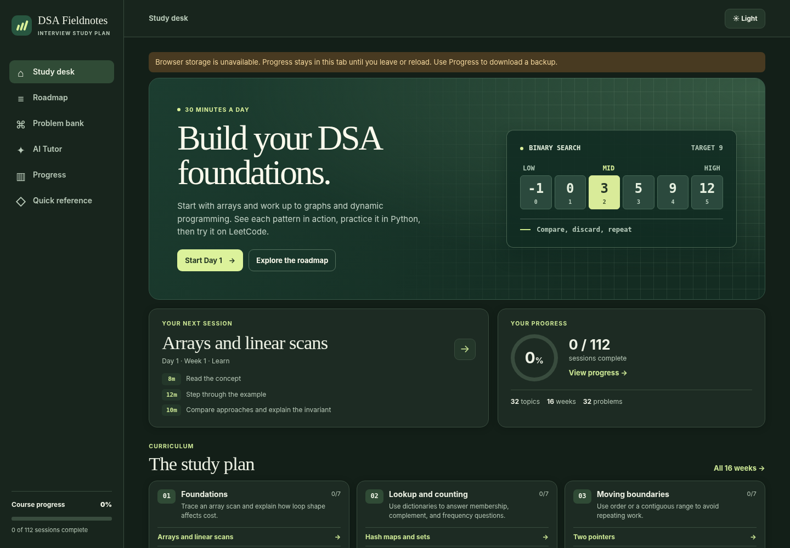
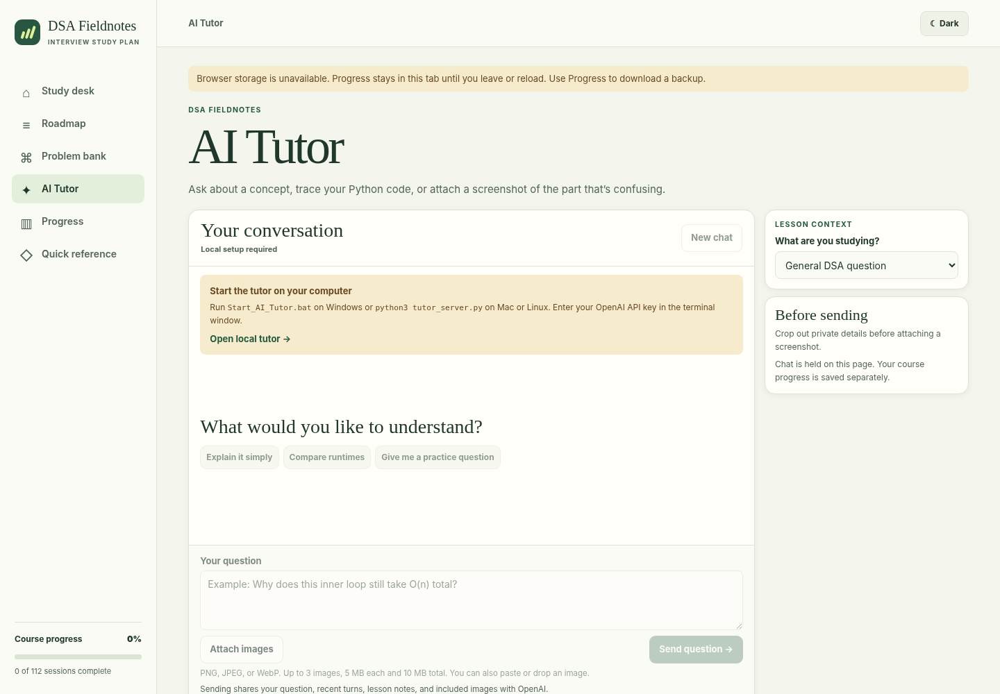
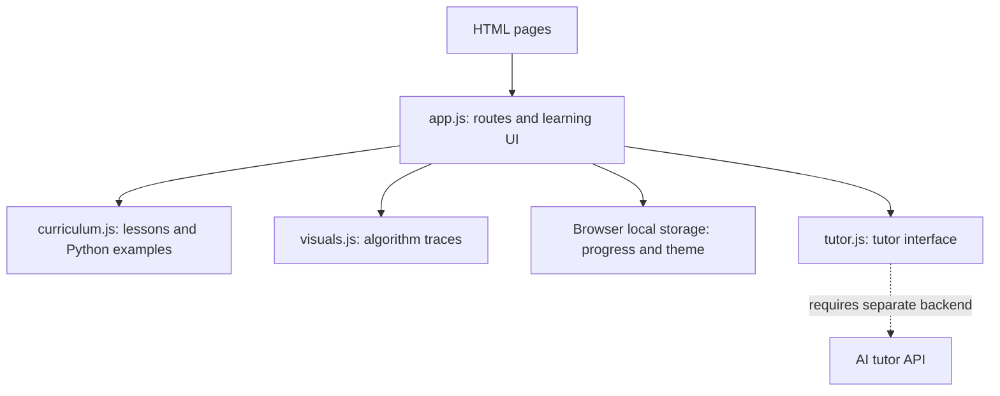

<div align="center">

# DSA Fieldnotes

### Learn the concept. Visualize the logic. Practice the problem.

A structured, interactive study desk for data structures and algorithms — built around 30 minutes of focused daily learning.

   

[Explore the roadmap](roadmap.html) · [Browse problems](practice.html) · [Quick reference](guide.html)



| 16 weeks | 112 sessions | 32 topics | 30 min/day |
| :---: | :---: | :---: | :---: |

</div>

## The learning experience



Each week includes two topics, with three sessions per topic and a final review day. Lessons connect algorithm invariants, concrete examples and time–space trade-offs to real problems.

## Explore the platform

| Roadmap | Problem bank |
| --- | --- |
|  |  |
| Search topics and navigate the 16-week curriculum. | Filter linked LeetCode problems by difficulty and practice status. |

### 01 · Learn through visual traces



Step through algorithm states, inspect intermediate values, play or pause the trace and adjust its speed. Supported visualizers also accept custom inputs. Each lesson connects the visualization to Python code and complexity analysis.

### 02 · Practice before looking at the answer



Predict outputs, work through a small coding exercise, then compare your reasoning with the provided solution. Continue to the corresponding LeetCode problem when ready.

### 03 · Track your learning

| Progress dashboard | Dark appearance |
| --- | --- |
|  |  |
| Mark sessions complete, track problem status, and export or import a JSON progress backup. | Switch between light and dark themes; preferences are saved in browser storage when available. |

### 04 · AI Tutor interface



The interface supports lesson-context questions, code explanations and image attachments. It is designed to communicate with a local tutor backend through `api/tutor/status` and `api/tutor`.

> **Availability:** This source archive contains the tutor frontend only. The referenced `tutor_server.py` and `Start_AI_Tutor.bat` are not included. Live AI responses require a compatible backend and an OpenAI API key managed by that backend. Do not put API keys in frontend JavaScript.

## Curriculum at a glance

| Weeks | Topics |
| --- | --- |
| 1–4 | Arrays, complexity, hashing, two pointers, sliding windows, prefix sums and sorting |
| 5–8 | Binary search, stacks, queues, linked lists, recursion and backtracking |
| 9–12 | Trees, heaps, tries, intervals, greedy reachability and graph traversal |
| 13–16 | Topological ordering, union-find, weighted graphs, dynamic programming, bit operations and Fenwick trees |

## How it works



```text
DSA Fieldnotes/
├── index.html          # Study desk
├── roadmap.html        # Curriculum navigation
├── practice.html       # LeetCode problem bank
├── progress.html       # Progress and backups
├── guide.html          # Quick reference
├── tutor.html          # Tutor interface
├── sessions/           # 112 lesson pages
├── assets/
│   ├── app.js          # App logic and state
│   ├── curriculum.js   # Topics and learning material
│   ├── visuals.js      # Interactive traces
│   ├── tutor.js        # Tutor frontend
│   └── style.css       # Responsive styling
└──    # UI previews
```

## Run locally

No build step or JavaScript package installation is required for the core learning platform.

1. Download and extract the repository.
2. Open `index.html` in your browser, or serve the folder locally:

   ```bash
   python -m http.server 8000
   ```

3. Visit `http://localhost:8000`.

A local HTTP server is recommended for consistent browser storage. LeetCode links require internet access. The Python examples are learning material, not an embedded Python execution environment.

## Deployment

The static learning platform can be hosted using GitHub Pages. Set Pages to deploy from the repository root on the desired branch. The AI Tutor requires a separately configured backend and is not enabled by static hosting alone.

---

<div align="center">

**Small daily steps. Stronger algorithmic thinking.**

</div>
